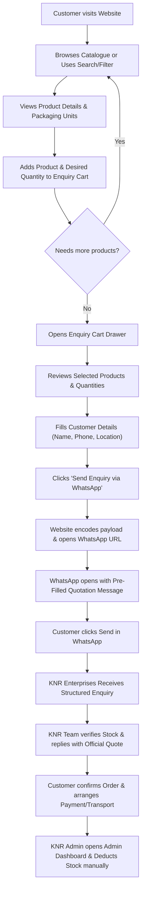
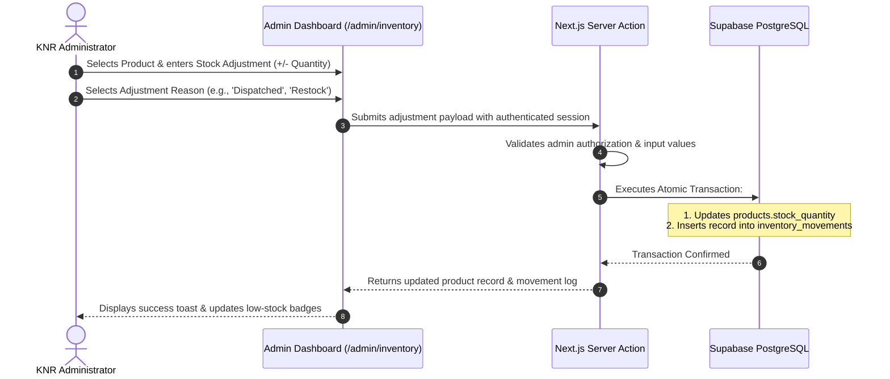

# KNR ENTERPRISES
## Product Requirements Document (PRD)
**Version:** 1.0  
**Date:** November 9, 2026  
**Document Status:** Approved Baseline for Implementation  

---

## 1. Document Information

| Attribute | Specification |
| :--- | :--- |
| **Project Name** | KNR Enterprises Digital B2B Platform & Management System |
| **Document Version** | 1.0 |
| **Document Status** | Approved Baseline |
| **Purpose** | Comprehensive product specification defining functional requirements, user experiences, data governance, and operational boundaries for the KNR Enterprises digital platform. |
| **Target Audience** | Software engineers, technical architects, QA testers, and business stakeholders. |
| **Last Updated** | November 9, 2026 |

---

## 2. Executive Summary

**KNR Enterprises** is a commercial B2B supply enterprise headquartered in Chevella, Ranga Reddy District, Telangana. The business specializes in supplying essential industrial chemicals, sanitation supplies, municipal infrastructure products, and safety equipment to commercial clients, regional contractors, and local institutions.

The objective of this project is to develop a premium, modern digital platform that bridges traditional B2B trading with streamlined digital interaction. The platform establishes an authoritative digital presence, presents an interactive product showcase, simplifies bulk product enquiries via structured WhatsApp messaging, and equips the business owners with a centralized, secure administration system for managing product listings and quantity-based inventory.

---

## 3. Business Information

All business details incorporated into this platform are strictly derived from verified corporate records. No unverified certifications, customer volumes, or historical narratives are assumed or fabricated.

| Field | Verified Business Detail |
| :--- | :--- |
| **Legal Trade Name** | **KNR ENTERPRISES** |
| **Registered Address** | H.No: 1-77/6, Near HP Petrol Pump, Mdl & Vill Chevella, Ranga Reddy District, Telangana — 501503, India |
| **Designated Contacts** | **K. Narendar Reddy** & **G. Siva** |
| **Primary Contact Numbers** | `+91 8886175855` / `+91 9640195798` |
| **Official Email** | `knrenterprises679@gmail.com` |
| **GSTIN** | `36CUHPK5939D1ZG` |
| **Operating Model** | Business-to-Business (B2B) Wholesaler & Commercial Supplier |
| **Core Product Lines** | 1. Bleaching Powder<br>2. Lime Powder<br>3. Malathion<br>4. Street Lights<br>5. Delta Fog<br>6. Dust Bins<br>7. Green Mat<br>8. Sanitization Tools & Equipment |

---

## 4. Problem Statement

Prior to this digital platform initiative, KNR Enterprises operated through conventional offline and telephone channels, leading to distinct operational friction points:

1. **Absence of a Professional Digital Presence:** Prospective institutional clients, municipal contractors, and commercial facilities searching for regional chemical and sanitation suppliers could not independently verify KNR Enterprises' legitimacy, catalogue, or physical location.
2. **Friction in Product Discovery:** Customers lacked a centralized, visual reference displaying standard packaging units, quality grades, and technical specifications for chemical powders and civic equipment.
3. **Manual Availability Communication:** Business owners continuously fielded repetitive calls regarding basic product specs and stock availability, pulling time away from fulfillment and operations.
4. **Disconnected Quotation Process:** Buyers requesting quotes frequently provided incomplete information (omitting delivery location, packaging units, or specific grades), prolonging pre-sale negotiations.
5. **Absence of Centralized Stock Tracking:** Inventory management relied on manual record-keeping, increasing the vulnerability to stock discrepancies, untracked stock adjustments, and unmonitored low-stock thresholds.

---

## 5. Project Objectives

The project delivers a custom-engineered web platform achieving the following measurable outcomes:

- **Authoritative Web Presence:** Deliver a high-performance web application communicating industrial strength, professional reliability, and clear business credentials.
- **Responsive Interactive Catalogue:** Enable intuitive product discovery across mobile, tablet, and desktop viewports with search and category filtering.
- **Direct WhatsApp Quotation Pipeline:** Provide an enquiry cart allowing customers to compile products with requested quantities and generate a formatted WhatsApp quotation inquiry with a single click.
- **Secure Single-Administrator Portal:** Implement an authenticated backend panel using Supabase Auth with server-enforced route protection.
- **Full Product CRUD & Media Control:** Enable business operators to create, update, archive, and manage product specifications and media.
- **Quantity-Based Inventory Tracking:** Maintain accurate physical stock tracking with configurable low-stock alerts, out-of-stock badges, and an immutable audit trail of stock adjustments.

---

## 6. Target Users

The platform addresses two distinct user categories. Note that these profiles represent intended commercial target audiences rather than verified empirical customer data:

1. **Commercial & Civil Contractors:** Local contractors executing infrastructure, sanitization, road works, and facility maintenance requiring bulk materials (lime, bleaching powder, street lighting).
2. **Institutional & Healthcare Buyers:** Hospitals, schools, colleges, and commercial complexes needing regular sanitization chemicals, dustbins, and groundskeeping mats.
3. **Panchayats & Municipal Authorities:** Regional village and town administration departments procuring public health supplies (fogging machines, malathion, street lights).
4. **Local Commercial Businesses:** Retailers, warehouses, and agricultural facilities in Ranga Reddy and adjoining districts seeking dependable chemical supplies.
5. **Business Administrator (KNR Management):** Internal operations managers (K. Narendar Reddy, G. Siva) maintaining product accuracy and monitoring inventory.

---

## 7. User Roles & Permissions

### Role Matrix

| Capability | Public Customer | Authenticated Administrator |
| :--- | :---: | :---: |
| Browse Public Catalogue & Details | Yes | Yes |
| Search & Filter Products | Yes | Yes |
| Add Products to Enquiry Cart | Yes | Yes |
| Generate Formatted WhatsApp Enquiry | Yes | Yes |
| View General Availability Status (In Stock / Out of Stock) | Yes | Yes |
| View Exact Numerical Stock Quantities | **No** (Hidden) | **Yes** |
| Access Admin Panel (`/admin/*`) | **No** (Redirected to Login) | **Yes** |
| Add, Edit, Archive Products | **No** | **Yes** |
| Upload Product Media | **No** | **Yes** |
| Adjust Inventory Quantities & Log Reasons | **No** | **Yes** |
| View Audit Trail of Inventory Movements | **No** | **Yes** |
| Update Business Contact Settings | **No** | **Yes** |

*Note: In Version 1.0, the platform supports a single authenticated administrator role.*

---

## 8. Functional Requirements

### FR-01: Homepage
- **Purpose:** Serve as the digital storefront establishing brand authority, highlighting core product sectors, showcasing verified credentials, and providing direct navigation.
- **Expected Behaviour:** Fast-loading, responsive landing page with an Industrial Premium design, prominent hero section, featured categories, quick enquiry trigger, business credentials, and map/location reference.
- **User Interaction:** Users can scroll, click category cards to jump to filtered catalogue views, trigger the enquiry modal, or initiate immediate telephone/WhatsApp contact.
- **Acceptance Criteria:** Page achieves high responsiveness, displays verified GSTIN and Chevella address, and exposes no broken links or placeholder texts.

### FR-02: Global Navigation & Footer
- **Purpose:** Provide continuous, intuitive navigation and contact accessibility across all pages.
- **Expected Behaviour:** Sticky, responsive header with company logo, navigation links (`Home`, `About`, `Products`, `Contact`), WhatsApp quick action button, and an Enquiry Cart icon with a dynamic badge counter. Mobile viewport displays an accessible sliding drawer.
- **Acceptance Criteria:** Cart counter accurately reflects total items in enquiry cart. Navigation collapses smoothly on mobile viewports (< 768px).

### FR-03: About Section & Company Verification
- **Purpose:** Detail the operating model of KNR Enterprises, geographic focus in Chevella/Telangana, and product domain expertise.
- **Expected Behaviour:** Clean presentation of company background, values, verified GSTIN, physical address, and designated leadership (K. Narendar Reddy and G. Siva).
- **Acceptance Criteria:** Strictly excludes unverified awards or fabricated historical figures.

### FR-04: Product Catalogue
- **Purpose:** Showcase all active products offered by KNR Enterprises in a clear, scannable grid.
- **Expected Behaviour:** Displays product cards with high-definition image, product title, category tag, packaging unit, quality grade, stock availability badge, and an "Add to Enquiry" button.
- **Acceptance Criteria:** Archived or inactive products do not appear in the public catalogue.

### FR-05: Product Search
- **Purpose:** Allow visitors to rapidly locate specific products by name, keyword, or application.
- **Expected Behaviour:** Instant client/server filtering as the user types into the search field, highlighting matching products without requiring full page reload.
- **Acceptance Criteria:** Sub-string matches on product name and description return accurate results within 100ms.

### FR-06: Category Filtering
- **Purpose:** Group products into logical industrial sectors for quick navigation.
- **Categories:**
  - Chemicals & Disinfectants (Bleaching Powder, Lime Powder, Malathion)
  - Civic & Municipal Infrastructure (Street Lights, Dust Bins)
  - Safety & Sanitation Equipment (Delta Fog, Green Mat, Sanitization Tools)
- **Acceptance Criteria:** Selecting a category button filters the grid instantaneously; an "All Products" reset option is always available.

### FR-07: Product Details Modal / Page
- **Purpose:** Present deep technical specifications, standard packaging, recommended handling, and bulk quotation options for a selected item.
- **Expected Behaviour:** High-resolution product image, detailed description, quality grade, packaging unit (e.g., 25 kg bag, 50 kg drum, piece), availability badge, quantity selector, and "Add to Enquiry" button.
- **Acceptance Criteria:** Modal or page opens cleanly with full ARIA accessibility attributes and URL shareability.

### FR-08: Public Availability Indicator
- **Purpose:** Inform customers whether a product is currently available for order without exposing private operational inventory metrics.
- **Expected Behaviour:**
  - If `stock_quantity > low_stock_threshold`: Display green badge **"In Stock"**.
  - If `stock_quantity > 0` and `<= low_stock_threshold`: Display amber badge **"Limited Stock"**.
  - If `stock_quantity == 0`: Display neutral/red badge **"Available on Order"** or **"Out of Stock"**.
- **Acceptance Criteria:** Numerical inventory quantities are never rendered in the client DOM or exposed in public API responses.

### FR-09: Enquiry Cart
- **Purpose:** Enable buyers to assemble multiple products into a single consolidated enquiry.
- **Expected Behaviour:** Side drawer displaying selected products, thumbnail, packaging unit, quantity increment/decrement controls, item removal, and total item count.
- **Acceptance Criteria:** Cart state persists in local storage (`localStorage`) so page reloads do not discard the customer's selections.

### FR-10: Customer Information Form
- **Purpose:** Collect essential buyer details to accompany the enquiry.
- **Fields:** Customer Name (Required), Business/Organization Name (Optional), Phone Number (Required), Delivery Location/Town (Required), Optional Notes/Requirements.
- **Acceptance Criteria:** Form validates phone numbers (10 digits) and prevents submission if mandatory fields are empty.

### FR-11: WhatsApp Integration & Message Compilation
- **Purpose:** Transmit the structured enquiry directly to KNR Enterprises' official business WhatsApp number without intermediary servers.
- **Expected Behaviour:** System serializes customer information and cart items into an encoded URL (`https://wa.me/918886175855?text=...`). On mobile devices, this launches WhatsApp natively; on desktop, it opens WhatsApp Web.
- **Sample Compiled Message:**
  ```text
  *ENQUIRY FOR KNR ENTERPRISES*
  -----------------------------------
  *Customer:* Rajesh Kumar
  *Company:* RK Infra Projects
  *Phone:* 9876543210
  *Location:* Chevella, Telangana
  -----------------------------------
  *Requested Products:*
  1. Bleaching Powder (Grade A) - 50 Bags (25 kg)
  2. Lime Powder - 20 Bags (50 kg)
  3. Street Light (72W LED) - 15 Units
  -----------------------------------
  *Notes:* Please quote best B2B price including delivery to Chevella site.
  ```
- **Acceptance Criteria:** Message correctly formats line breaks and special characters with URL encoding (`encodeURIComponent`).

### FR-12: Administrator Authentication
- **Purpose:** Protect administrative functions behind secure credentials.
- **Expected Behaviour:** Secure email and password login page (`/admin/login`). Integrates with Supabase Auth. Issues HTTP-only, secure session cookies.
- **Acceptance Criteria:** Unauthenticated requests to `/admin/*` routes are intercepted by Next.js middleware and redirected to `/admin/login`.

### FR-13: Admin Dashboard Overview
- **Purpose:** Provide administrators with an immediate operational snapshot upon login.
- **Expected Behaviour:** Summary stat cards showing: Total Active Products, Low-Stock Alerts Count, Total Inventory Items, Quick Action links, and Recent Stock Activity table.
- **Acceptance Criteria:** Accurately calculates real-time counts from the database upon render.

### FR-14: Product CRUD Management
- **Purpose:** Enable full lifecycle administration of product listings.
- **Expected Behaviour:**
  - Create: Add new product with name, slug (auto-generated or manual), category, description, quality grade, packaging unit, initial stock, low-stock threshold, and image upload.
  - Read: Searchable, sortable tabular list of all products.
  - Update: Edit specifications, grades, pricing notes, and active status.
  - Archive/Delete: Soft-delete toggle (`is_active = false`) preventing accidental loss of historical records.
- **Acceptance Criteria:** Changes reflect immediately in both the admin list and public catalogue.

### FR-15: Inventory Quantity Control
- **Purpose:** Allow rapid, auditable adjustments of physical stock quantities.
- **Expected Behaviour:** Dedicated stock control interface where an admin can select a product, input a quantity change (positive addition or negative deduction), select a structured reason (e.g., "New Stock Arrival", "Order Dispatched", "Physical Count Correction", "Damaged / Expired"), and record notes.
- **Acceptance Criteria:** Stock update automatically commits an entry to the `inventory_movements` audit table in a single atomic transaction.

### FR-16: Low-Stock Monitoring
- **Purpose:** Prevent stockouts of high-demand municipal and commercial chemicals.
- **Expected Behaviour:** Filterable dashboard view highlighting all items where `stock_quantity <= low_stock_threshold`. Highlights urgent items in amber/red.
- **Acceptance Criteria:** Products at or below threshold trigger immediate visual indicators in both the dashboard and inventory management tables.

### FR-17: Inventory Movement Audit History
- **Purpose:** Provide transparency and accountability for all physical stock alterations.
- **Expected Behaviour:** Chronological, paginated audit log detailing: Timestamp, Product Name, Admin User, Previous Quantity, Adjustment Delta, New Quantity, and Reason Note.
- **Acceptance Criteria:** Historical entries are immutable and cannot be edited or deleted by application users.

### FR-18: Business Settings Configuration
- **Purpose:** Allow the administrator to update public contact coordinates without code redeployment.
- **Expected Behaviour:** Settings interface to manage primary WhatsApp recipient phone number, secondary contact phone, email address, and operating hours.
- **Acceptance Criteria:** Updated contact numbers immediately alter the destination URL for all generated WhatsApp enquiries.

---

## 9. Non-Functional Requirements

### 9.1 Performance
- **Server-Side Rendering (SSR) & Static Optimization:** Public catalogue and landing pages utilize Next.js static and server rendering for near-instant Time to First Byte (TTFB < 200ms on edge).
- **Asset Optimization:** All product images served via `next/image` in modern WebP/AVIF formats with responsive `srcset` generation and lazy loading.
- **Bundle Footprint:** Client bundles minimized via Next.js App Router tree-shaking; zero bloated client dependencies.

### 9.2 Accessibility (a11y)
- Target conformance with **WCAG 2.1 Level AA**.
- Minimum contrast ratio of 4.5:1 for normal text and 3:1 for large text across light and dark elements.
- Accessible ARIA labels on icon buttons (cart toggles, search inputs, modal close triggers).
- Full keyboard navigability (visible focus indicators, Esc key modal dismissal).

### 9.3 Responsiveness & Viewport Adaptability
- Fluid layout support spanning:
  - Mobile Phones: 320px – 640px
  - Tablets: 641px – 1024px
  - Desktop Displays: 1025px – 1920px+
- Touch target sizes conform to minimum 44px x 44px on mobile devices.

### 9.4 Security & Privacy
- **Defense in Depth:** Supabase Row Level Security (RLS) policies enforce data isolation directly at the database layer.
- **Zero Public Exposure of Critical Data:** Internal stock counts, admin emails, and audit tables are unreachable by anonymous queries.
- **Sanitized Inputs:** All customer enquiry strings and admin input forms sanitized to prevent Cross-Site Scripting (XSS).
- **Zero Secret Exposure:** Database service-role keys and private credentials reside solely in server environments and are never bundled into client scripts.

### 9.5 Reliability & Maintainability
- 100% strict TypeScript typing across all application modules, database schemas, and component interfaces.
- Zero ESLint warnings or build errors tolerated in production builds.

### 9.6 Search Engine Optimization (SEO)
- Automated OpenGraph and Twitter card meta-tags.
- Canonical URL generation and dynamic sitemap (`sitemap.xml`) generation.
- Structured schema markup (`JSON-LD`) for `LocalBusiness` incorporating verified GSTIN, address, and contact numbers.

---

## 10. Product Ordering Workflow

Because KNR Enterprises operates in bulk B2B wholesale where freight, packaging, and quantity-specific pricing vary, orders are finalized via direct communication rather than automated retail credit card checkout.



> [!IMPORTANT]
> **No Automated Order Finalization:** The website does **not** process financial transactions or automatically confirm orders. WhatsApp serves as the direct sales communication link.

---

## 11. Inventory Management Workflow

The platform maintains strict physical stock integrity through an auditable administrative workflow:



### Key Principles of Stock Logic:
1. **No Automatic Deduction on WhatsApp Click:** Clicking the WhatsApp button on the frontend does **not** deduct stock, as customer enquiries do not represent completed sales.
2. **Manual Reconciliation:** Following confirmed customer payment and dispatch, the KNR Administrator manually logs the deduction in `/admin/inventory`.
3. **Immutable History:** Every stock modification creates a permanent, non-editable row in `inventory_movements` preserving previous quantity, adjustment amount, new quantity, admin ID, timestamp, and rationale.

---

## 12. UI/UX Design System Requirements

### Brand Aesthetic: Industrial Premium + Minimal Corporate
The aesthetic communicates structural resilience, industrial reliability, and modern efficiency. Clean lines, high-contrast typography, generous negative space, and refined color blocking replace cluttered retail aesthetics.

### Color Tokens

| Token Name | Hex Code | Purpose |
| :--- | :--- | :--- |
| **Primary Navy** | `#101B32` | Primary brand background, deep hero containers, major headers. |
| **Secondary Navy** | `#192943` | Surface card containers, table headers, elevated cards. |
| **Accent Orange** | `#FF8A24` | Primary call-to-action buttons, active badges, highlights, focus rings. |
| **Graphite** | `#303846` | Secondary typography, subtle borders, divider lines. |
| **Off-White Surface**| `#F5F6F8` | Page body background in light mode, neutral contrast sections. |
| **Pure White** | `#FFFFFF` | Card backgrounds, light text contrast on dark navy. |

### Visual Elements
- **Typography:** Modern, legible sans-serif typefaces (Geist / Inter) with distinct geometric hierarchy.
- **Imagery:** Crisp, authentic product photography with subtle rounded container corners (`rounded-xl` / `rounded-2xl`).
- **Motion:** Micro-interactions powered by `motion` (smooth fade-ins, card hover elevation, tactile button depress feedback).

---

## 13. Sitemap & Route Hierarchy

```text
/ (Home)
├── /about (Company Profile, Leadership, Location, Verification)
├── /products (Searchable & Filterable Product Catalogue)
│   └── /products/[slug] (Deep Product Specification & Direct Enquiry)
├── /contact (Physical Address, Interactive Map, Contact Numbers, Business Email)
└── /admin (Protected Administrative Zone)
    ├── /admin/login (Administrator Authentication Portal)
    ├── /admin/dashboard (High-level Metrics & Stock Alerts)
    ├── /admin/products (Product CRUD & Media Uploads)
    ├── /admin/inventory (Stock Adjustments & Audit Movement Log)
    └── /admin/settings (Business Contact Configuration)
```

---

## 14. Scope Management

### 14.1 In Scope for Version 1.0
- Next.js App Router website with full mobile responsiveness.
- Public product showcase with search, category filtering, and modal detail views.
- Enquiry Cart with client-side persistence and formatted WhatsApp message generation.
- Responsive layout with Industrial Premium branding and verified business credentials.
- Protected `/admin` suite powered by Supabase Auth with server-side middleware validation.
- Product CRUD (Name, slug, category, description, quality grade, packaging unit, image, active status).
- Centralized inventory management with stock adjustments, low-stock threshold configuration, and append-only movement history.
- Supabase Storage integration for product images.
- Basic business settings (editable contact numbers for WhatsApp enquiry routing).
- Comprehensive SEO metadata, sitemap, and LocalBusiness JSON-LD structured data.

### 14.2 Out of Scope for Version 1.0 (Deferred to Future Phases)
- Integrated online payment gateway (Razorpay, Stripe, UPI checkout).
- Automated two-way WhatsApp Business API integration (Cloud API webhook processing).
- Automatic inventory deduction on WhatsApp click.
- Multi-role administrator permissions (Role-Based Access Control with fine-grained privileges).
- Automated GST invoice generation or tax accounting module.
- External ERP or warehouse tally integration.
- Direct customer account creation or customer login portal.

---

## 15. Acceptance Criteria

The system will be evaluated and accepted based on the following criteria:

1. **Brand Authenticity:** All pages display verified corporate coordinates: Chevella, Ranga Reddy address, K. Narendar Reddy and G. Siva contact references, and GSTIN `36CUHPK5939D1ZG`.
2. **Navigation & Responsiveness:** Platform navigates seamlessly without horizontal scrollbars or element collisions across viewports from 320px to 1920px.
3. **Product Discovery:** Search input filters products in real time (< 100ms response). Category pills instantly filter the grid.
4. **Enquiry Generation:** Adding multiple items to the cart and submitting customer details generates a correctly formatted, encoded WhatsApp message that launches WhatsApp with the verified contact number.
5. **Security & Data Privacy:** Unauthenticated users cannot access `/admin/*` routes. Public API/database queries reveal zero exact numerical inventory figures or audit history.
6. **Stock Integrity:** Every admin stock adjustment accurately alters `stock_quantity` and generates a corresponding record in `inventory_movements`.
7. **Code Quality:** Zero TypeScript compilation errors (`tsc --noEmit`), zero ESLint errors (`npm run lint`), and a clean production build (`npm run build`).

---

## 16. Risks and Assumptions

| Risk / Dependency | Impact | Mitigation Strategy |
| :--- | :--- | :--- |
| **Product Photography Availability** | High | Standardized placeholder silhouettes will be configured until physical product photographs are supplied and approved by KNR management. |
| **Chemical Claims & Specifications** | High | Chemical technical details (grades, active percentages) must remain strictly informational without medical or unlicensed pesticide claims. |
| **WhatsApp Number Accuracy** | High | Destination numbers (`8886175855`, `9640195798`) are centralized in configuration settings so changes require no codebase rewrites. |
| **Supabase Free Tier Quotas** | Medium | Free tier allows 500MB database storage and 1GB file storage, which is more than sufficient for V1 product counts. Image optimization prevents storage exhaustion. |
| **Stock Reconciliation Lag** | Medium | Because stock adjustments are manual following WhatsApp sales, clear operational guidelines are provided to business owners to reconcile stock daily. |

---

## 17. Future Roadmap (Post-V1 Considerations)

- **Phase 2:** Automated WhatsApp Business API integration with interactive buttons for real-time order status tracking.
- **Phase 3:** Automated PDF Quotation Generator allowing institutional buyers to download official formal estimates.
- **Phase 4:** Multi-user staff permissions (e.g., Warehouse Dispatcher vs. Business Owner).
- **Phase 5:** GST Invoicing and E-way bill generation integration.

