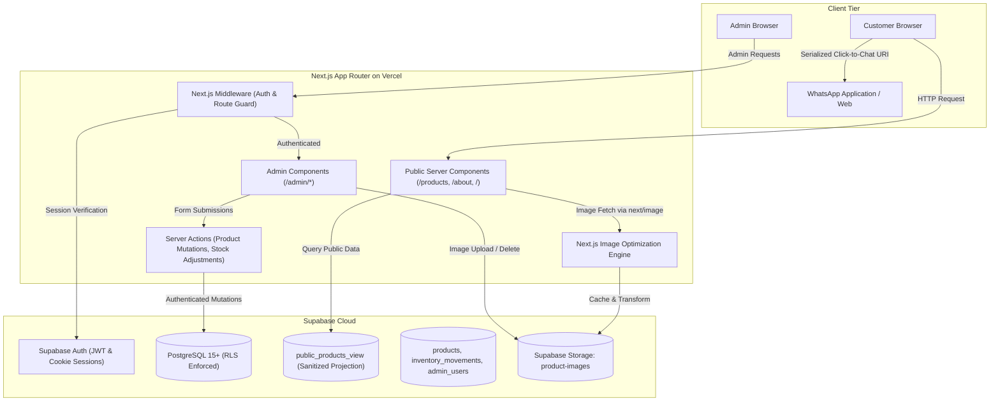
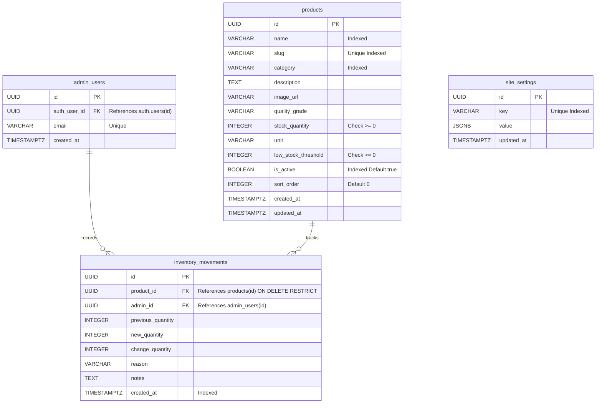
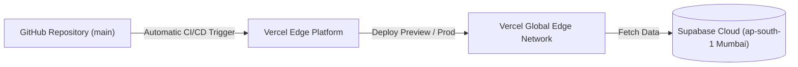

# KNR ENTERPRISES
## Technical Requirements Document (TRD)
**Version:** 1.0  
**Date:** November 9, 2026  
**Document Status:** Engineering Architecture Specification  

---

## 1. Technical Overview

This Technical Requirements Document (TRD) establishes the architectural foundation, engineering patterns, data models, and security boundaries for the **KNR ENTERPRISES** digital platform. 

The application is engineered as a modern, high-performance, full-stack web application leveraging the **Next.js App Router (v16.4.5)**, **TypeScript**, and **Tailwind CSS (v4)**. Backend data persistence, authentication, and binary object storage are architected around **Supabase (PostgreSQL 15+, Supabase Auth, and Supabase Storage)**.

### Primary Engineering Objectives
1. **Server-First Rendering & Performance:** Utilize React Server Components (RSC) to maximize performance, minimize client JavaScript payload, and protect proprietary operational data.
2. **Strict Security Boundaries:** Prevent unauthorized access to business logic, administrative suites, and internal inventory quantities through database-level Row Level Security (RLS) and server-side route guards.
3. **Resilient Data Architecture:** Guarantee transactional consistency across physical inventory adjustments through atomic database operations and an immutable audit log.
4. **Frictionless Communication Protocol:** Serialize complex enquiry structures into standards-compliant WhatsApp click-to-chat URIs for rapid B2B quotation.

---

## 2. Technology Stack

### 2.1 Currently Installed Dependencies

| Package | Version | Purpose |
| :--- | :--- | :--- |
| **`next`** | `^16.4.5` | Next.js App Router framework with Turbopack bundler |
| **`react`** | `^19.3.1` | Core React library (React 19 Server & Client components) |
| **`react-dom`** | `^19.3.1` | React DOM rendering engine |
| **`typescript`** | `^6.0.3` | Static typing and compile-time verification |
| **`tailwindcss`** | `^4.3.5` | Modern utility-first styling engine (v4 architecture) |
| **`@tailwindcss/postcss`** | `^4.3.5` | PostCSS plugin for Tailwind CSS v4 |
| **`postcss`** | `^8.5.32` | CSS transformation engine |
| **`motion`** | `^14.11.1` | High-performance declarative animation engine |
| **`lucide-react`** | `^1.70.0` | Accessible, tree-shakeable icon library |
| **`clsx`** | `^2.1.1` | Dynamic conditional class construction utility |
| **`tailwind-merge`** | `^3.7.0` | Conflict-free Tailwind CSS class merging (`cn` utility) |
| **`eslint`** | `^9.39.5` | Static code analysis and linting |
| **`eslint-config-next`** | `^16.4.5` | Next.js core web vitals and typescript linting rules |

### 2.2 Planned Backend Dependencies (Phase 3 Integration)

| Package | Intended Role |
| :--- | :--- |
| **`@supabase/supabase-js`** | Official Supabase client for database operations and file storage |
| **`@supabase/ssr`** | Cookie-based SSR authentication helper for Next.js App Router |
| **`zod`** | Schema validation for customer enquiries and admin mutation inputs |

---

## 3. System Architecture

The system operates across three tiers:
1. **Client Tier (Browser):** Renders public UI, maintains client-side enquiry cart state, and handles WhatsApp protocol handoff.
2. **Application Tier (Next.js App Router):** Executes Server Components, processes Server Actions, handles authentication middleware, and enforces data projection.
3. **Persistence Tier (Supabase):** Manages relational data (PostgreSQL), session tokens (Supabase Auth), and product imagery (Supabase Storage).



---

## 4. Application Folder Structure

The project strictly resides within `D:\KNR Enterprises`. The intended folder organization aligns with Next.js App Router best practices:

```text
D:\KNR Enterprises\
├── .env.example                     # Sample configuration and placeholder keys
├── .gitignore                       # Strict Git exclusion rules
├── AGENTS.md                        # Next.js guidelines for AI coding agents
├── eslint.config.mjs                # ESLint Flat Config
├── next.config.ts                   # Next.js build and runtime configuration
├── package.json                     # Dependency manifests and scripts
├── postcss.config.mjs               # PostCSS & Tailwind v4 plugin definition
├── README.md                        # Master onboarding and developer guide
├── tsconfig.json                    # TypeScript compiler configuration (@/* paths)
│
├── docs\                            # Technical and architectural documentation
│   ├── PRD.md                       # Product Requirements Document
│   └── TRD.md                       # Technical Requirements Document
│
├── public\                          # Static public assets
│   ├── favicon.ico                  # Application icon
│   ├── images\                      # Static raster images
│   │   ├── hero\                    # Industrial hero visuals
│   │   ├── products\                # Product fallback silhouettes
│   │   └── general\                 # General marketing visuals
│   ├── logo\                        # Official KNR Enterprises vector logos
│   └── icons\                       # Custom SVG vector icons
│
├── src\
│   ├── app\                         # Next.js App Router routes and page entrypoints
│   │   ├── globals.css              # Global styles & Tailwind v4 @import
│   │   ├── layout.tsx               # Root application layout (HTML, fonts, metadata)
│   │   ├── page.tsx                 # Public homepage entrypoint
│   │   ├── about\                   # About Us page
│   │   │   └── page.tsx
│   │   ├── products\                # Product catalogue routes
│   │   │   ├── page.tsx             # Filterable product grid
│   │   │   └── [slug]\              # Deep product details page
│   │   │       └── page.tsx
│   │   ├── contact\                 # Contact & location details page
│   │   │   └── page.tsx
│   │   └── admin\                   # Protected Administrative Suite
│   │       ├── login\               # Admin login form
│   │       │   └── page.tsx
│   │       ├── dashboard\           # Metrics, alerts, and recent movements
│   │       │   └── page.tsx
│   │       ├── products\            # Product CRUD and media management
│   │       │   └── page.tsx
│   │       ├── inventory\           # Stock adjustment interface and audit logs
│   │       │   └── page.tsx
│   │       └── settings\            # Business contact configuration
│   │           └── page.tsx
│   │
│   ├── components\                  # Reusable UI component library
│   │   ├── layout\                  # Header, Footer, Mobile Drawer, Sticky WhatsApp
│   │   ├── home\                    # Hero, CategoryGrid, TrustBadges, LocationCard
│   │   ├── products\                # ProductCard, ProductGrid, ProductFilters, SearchBar
│   │   ├── enquiry\                 # EnquiryCartDrawer, EnquiryItemRow, CustomerForm
│   │   ├── admin\                   # AdminNav, StatCard, ProductForm, StockAdjustmentModal
│   │   └── ui\                      # Atomic primitives: Button, Modal, Badge, Input, Table
│   │
│   ├── lib\                         # Core utilities, clients, and schemas
│   │   ├── utils\                   # Helper utilities (cn class merger, formatters)
│   │   │   └── index.ts
│   │   ├── validations\             # Input validation schemas (enquiry, product, stock)
│   │   └── supabase\                # Supabase SSR client, server client, and admin client
│   │
│   ├── hooks\                       # Custom React hooks (useCart, useDebounce, useMediaQuery)
│   ├── types\                       # TypeScript definitions (Product, Movement, Enquiry, User)
│   └── config\                      # Centralized constants (siteConfig, categories, contact)
│
└── supabase\                        # Database migrations and seed datasets
    └── migrations\                  # SQL DDL migrations for PostgreSQL schema and RLS
```

---

## 5. Frontend Architecture

### 5.1 App Router Conventions
- **Server Components by Default:** All routes in `src/app/` are React Server Components (RSC) unless interactivity or browser APIs are explicitly required. This guarantees minimal client bundle sizes and allows direct database reading without exposing API endpoints.
- **Client Components (`"use client"`):** Restricted to leaf components requiring local state, event listeners, or browser APIs (e.g., `EnquiryCartDrawer`, `ProductFilters`, `SearchBar`, `AdminModal`).

### 5.2 State Management
- **Enquiry Cart State:** Handled by a dedicated React Context (`CartContext`) backed by `localStorage` persistence. Cart data consists only of `{ productId, name, slug, unit, requestedQuantity }`.
- **Search & Filter State:** Synced with URL search parameters (`?category=chemicals&q=bleach`) via Next.js `useSearchParams` and `useRouter` to enable shareable links and browser back/forward navigation.

### 5.3 Styling & Design Tokens (Tailwind CSS v4)
Tailwind CSS v4 replaces legacy JavaScript config files (`tailwind.config.ts`) with modern CSS `@theme` directives configured in [`src/app/globals.css`](file:///D:/KNR%20Enterprises/src/app/globals.css):
```css
@import "tailwindcss";

@theme {
  --color-navy-primary: #101b32;
  --color-navy-secondary: #192943;
  --color-orange-accent: #ff8a24;
  --color-graphite: #303846;
  --color-surface-light: #f5f6f8;
}
```

---

## 6. Route Architecture

| Route Path | Rendering Strategy | Access Tier | Primary Component Responsibilities | Data Dependencies |
| :--- | :--- | :--- | :--- | :--- |
| **`/`** | Server Component (Static/ISR) | Public | Hero banner, value props, featured products, map preview | Top 6 active products via public view |
| **`/about`** | Server Component (Static) | Public | Corporate overview, verified GSTIN, leadership profiles | Static configuration |
| **`/products`** | Server Component + Client Filter | Public | Product search bar, category tabs, responsive grid | Active products via public view |
| **`/products/[slug]`** | Server Component (Dynamic) | Public | Detailed specifications, packaging info, direct enquiry CTA | Single product by slug via public view |
| **`/contact`** | Server Component (Static) | Public | Physical address in Chevella, phone links, Google Maps iframe | Business contact configuration |
| **`/admin/login`** | Client Component | Public | Email and password authentication form | Supabase Auth API |
| **`/admin/dashboard`**| Server Component | Protected | Metric stat cards, low-stock alerts, recent movement log | Counts from `products` and `inventory_movements` |
| **`/admin/products`** | Server Component + Client Modal| Protected | Product table, search, create/edit modal, image upload | Full `products` table |
| **`/admin/inventory`**| Server Component + Client Modal| Protected | Stock level table, quick adjust modal, movement log table | `products` and `inventory_movements` join |
| **`/admin/settings`** | Server Component + Client Form | Protected | Business contact number, email, and address settings | `site_settings` table |

---

## 7. Database Architecture

### 7.1 PostgreSQL Relational Schema



### 7.2 Table Definitions & Data Constraints

#### Table A: `admin_users`
Explicit allowlist linking Supabase Auth users to administrative privileges:
```sql
CREATE TABLE public.admin_users (
    id UUID PRIMARY KEY DEFAULT gen_random_uuid(),
    auth_user_id UUID NOT NULL UNIQUE REFERENCES auth.users(id) ON DELETE CASCADE,
    email VARCHAR(255) NOT NULL UNIQUE,
    created_at TIMESTAMPTZ NOT NULL DEFAULT timezone('utc'::text, now())
);
```

#### Table B: `products`
Master catalog of all commercial and industrial products:
```sql
CREATE TABLE public.products (
    id UUID PRIMARY KEY DEFAULT gen_random_uuid(),
    name VARCHAR(255) NOT NULL,
    slug VARCHAR(255) NOT NULL UNIQUE,
    category VARCHAR(100) NOT NULL,
    description TEXT,
    image_url TEXT,
    quality_grade VARCHAR(100),
    stock_quantity INTEGER NOT NULL DEFAULT 0 CHECK (stock_quantity >= 0),
    unit VARCHAR(50) NOT NULL DEFAULT 'Bags',
    low_stock_threshold INTEGER NOT NULL DEFAULT 10 CHECK (low_stock_threshold >= 0),
    is_active BOOLEAN NOT NULL DEFAULT true,
    sort_order INTEGER NOT NULL DEFAULT 0,
    created_at TIMESTAMPTZ NOT NULL DEFAULT timezone('utc'::text, now()),
    updated_at TIMESTAMPTZ NOT NULL DEFAULT timezone('utc'::text, now())
);

CREATE INDEX idx_products_category ON public.products(category);
CREATE INDEX idx_products_is_active ON public.products(is_active);
CREATE INDEX idx_products_slug ON public.products(slug);
```

#### Table C: `inventory_movements`
Immutable, append-only log of every physical quantity change:
```sql
CREATE TABLE public.inventory_movements (
    id UUID PRIMARY KEY DEFAULT gen_random_uuid(),
    product_id UUID NOT NULL REFERENCES public.products(id) ON DELETE RESTRICT,
    admin_id UUID NOT NULL REFERENCES public.admin_users(id),
    previous_quantity INTEGER NOT NULL,
    new_quantity INTEGER NOT NULL,
    change_quantity INTEGER NOT NULL,
    reason VARCHAR(100) NOT NULL,
    notes TEXT,
    created_at TIMESTAMPTZ NOT NULL DEFAULT timezone('utc'::text, now())
);

CREATE INDEX idx_movements_product_id ON public.inventory_movements(product_id);
CREATE INDEX idx_movements_created_at ON public.inventory_movements(created_at DESC);
```

#### Table D: `site_settings`
Configurable business settings:
```sql
CREATE TABLE public.site_settings (
    id UUID PRIMARY KEY DEFAULT gen_random_uuid(),
    key VARCHAR(100) NOT NULL UNIQUE,
    value JSONB NOT NULL,
    updated_at TIMESTAMPTZ NOT NULL DEFAULT timezone('utc'::text, now())
);
```

---

## 8. Public Data Security Design

### 8.1 The Threat Model
Exposing exact physical stock quantities in the public browser reveals sensitive operational volume to competitors and buyers, weakening the business's B2B negotiation position.

### 8.2 Architectural Mitigation: Database View Projection
To enforce strict data isolation, anonymous public clients are **never** granted direct access to `products` or `inventory_movements`. Instead, public requests read from a secure PostgreSQL View that calculates availability status without exposing raw counts:

```sql
CREATE OR REPLACE VIEW public.public_products_view AS
SELECT 
    id,
    name,
    slug,
    category,
    description,
    image_url,
    quality_grade,
    unit,
    is_active,
    sort_order,
    CASE 
        WHEN stock_quantity > low_stock_threshold THEN 'IN_STOCK'
        WHEN stock_quantity > 0 AND stock_quantity <= low_stock_threshold THEN 'LOW_STOCK'
        ELSE 'OUT_OF_STOCK'
    END AS availability_status
FROM public.products
WHERE is_active = true;
```

---

## 9. Authentication & Authorization

### 9.1 Authentication Provider
Authentication is managed via **Supabase Auth** utilizing standard email and password credentials.

### 9.2 Session Management in Next.js App Router
1. Login requests submit credentials to a server-side action invoking `supabase.auth.signInWithPassword`.
2. Supabase issues JWT access and refresh tokens.
3. Tokens are serialized into secure, `HttpOnly`, `SameSite=Lax`, encrypted cookies via `@supabase/ssr`.
4. Client components never have direct access to raw session tokens.

### 9.3 Middleware Route Guard (`middleware.ts`)
Next.js Edge Middleware intercepts incoming requests matching `/admin/:path*` (excluding `/admin/login`):
- If the session token is absent or invalid, the request is redirected:
  `NextResponse.redirect(new URL('/admin/login', request.url))`
- If the token is valid, the middleware queries the `admin_users` table to confirm the user ID exists in the admin allowlist. If unlisted, the session is invalidated and redirected.

---

## 10. Row Level Security (RLS) Policies

Row Level Security is enabled on all tables:

```sql
ALTER TABLE public.admin_users ENABLE ROW LEVEL SECURITY;
ALTER TABLE public.products ENABLE ROW LEVEL SECURITY;
ALTER TABLE public.inventory_movements ENABLE ROW LEVEL SECURITY;
ALTER TABLE public.site_settings ENABLE ROW LEVEL SECURITY;
```

### 10.1 Policies for `products`
```sql
-- Deny all anonymous read access to raw products table (public uses view)
CREATE POLICY "Deny anonymous access to raw products" 
ON public.products 
FOR ALL 
TO anon 
USING (false);

-- Allow authenticated admins full access
CREATE POLICY "Allow authenticated admins full product access" 
ON public.products 
FOR ALL 
TO authenticated 
USING (
    EXISTS (SELECT 1 FROM public.admin_users WHERE auth_user_id = auth.uid())
)
WITH CHECK (
    EXISTS (SELECT 1 FROM public.admin_users WHERE auth_user_id = auth.uid())
);
```

### 10.2 Policies for `inventory_movements`
```sql
-- Deny all anonymous access to inventory logs
CREATE POLICY "Deny anonymous access to inventory movements" 
ON public.inventory_movements 
FOR ALL 
TO anon 
USING (false);

-- Allow admins to read audit logs
CREATE POLICY "Allow admins to read inventory movements" 
ON public.inventory_movements 
FOR SELECT 
TO authenticated 
USING (
    EXISTS (SELECT 1 FROM public.admin_users WHERE auth_user_id = auth.uid())
);

-- Allow admins to insert new logs (never update or delete)
CREATE POLICY "Allow admins to insert inventory movements" 
ON public.inventory_movements 
FOR INSERT 
TO authenticated 
WITH CHECK (
    EXISTS (SELECT 1 FROM public.admin_users WHERE auth_user_id = auth.uid())
);
```

---

## 11. Inventory Adjustment Logic

All stock quantity updates are performed through a dedicated PostgreSQL Stored Function (`adjust_stock`) to prevent race conditions and guarantee atomic execution:

```sql
CREATE OR REPLACE FUNCTION public.adjust_stock(
    p_product_id UUID,
    p_change_quantity INTEGER,
    p_reason VARCHAR(100),
    p_notes TEXT DEFAULT NULL
)
RETURNS JSONB
LANGUAGE plpgsql
SECURITY DEFINER
AS $$
DECLARE
    v_admin_id UUID;
    v_current_stock INTEGER;
    v_new_stock INTEGER;
    v_product_name VARCHAR(255);
BEGIN
    -- Verify caller is registered admin
    SELECT id INTO v_admin_id 
    FROM public.admin_users 
    WHERE auth_user_id = auth.uid();
    
    IF v_admin_id IS NULL THEN
        RAISE EXCEPTION 'Unauthorized: User is not an active administrator.';
    END IF;

    -- Lock row for update to prevent concurrent race condition
    SELECT stock_quantity, name INTO v_current_stock, v_product_name
    FROM public.products
    WHERE id = p_product_id
    FOR UPDATE;

    IF v_current_stock IS NULL THEN
        RAISE EXCEPTION 'Product not found.';
    END IF;

    v_new_stock := v_current_stock + p_change_quantity;

    IF v_new_stock < 0 THEN
        RAISE EXCEPTION 'Insufficient stock. Adjustment would result in negative quantity (%).', v_new_stock;
    END IF;

    -- Update master product quantity
    UPDATE public.products
    SET stock_quantity = v_new_stock,
        updated_at = timezone('utc'::text, now())
    WHERE id = p_product_id;

    -- Commit immutable audit movement
    INSERT INTO public.inventory_movements (
        product_id,
        admin_id,
        previous_quantity,
        new_quantity,
        change_quantity,
        reason,
        notes
    ) VALUES (
        p_product_id,
        v_admin_id,
        v_current_stock,
        v_new_stock,
        p_change_quantity,
        p_reason,
        p_notes
    );

    RETURN jsonb_build_object(
        'success', true,
        'product_id', p_product_id,
        'previous_quantity', v_current_stock,
        'new_quantity', v_new_stock
    );
END;
$$;
```

---

## 12. Image Storage Architecture

### 12.1 Bucket Configuration
- **Bucket ID:** `product-images`
- **Visibility:** Public Read Access (`public: true`)
- **Permitted File Formats:** `image/jpeg`, `image/png`, `image/webp`
- **Maximum File Size:** 5 MB per file
- **File Naming Standard:** `products/{product_slug}-{timestamp}.{extension}`

### 12.2 Supabase Storage RLS Policies
```sql
-- Allow public anonymous read access to product images
CREATE POLICY "Public read product images" 
ON storage.objects FOR SELECT 
TO public 
USING (bucket_id = 'product-images');

-- Allow only authenticated admins to upload images
CREATE POLICY "Admins upload product images" 
ON storage.objects FOR INSERT 
TO authenticated 
WITH CHECK (
    bucket_id = 'product-images' AND
    EXISTS (SELECT 1 FROM public.admin_users WHERE auth_user_id = auth.uid())
);
```

---

## 13. WhatsApp Integration

### 13.1 Message Compilation Protocol
The enquiry cart serializes customer selections into a structured, human-readable text string.

```typescript
export function generateWhatsAppUrl(
  phoneNumber: string, 
  customer: CustomerDetails, 
  items: CartItem[]
): string {
  const cleanPhone = phoneNumber.replace(/[^0-9]/g, "");
  
  let message = `*ENQUIRY FOR KNR ENTERPRISES*\n`;
  message += `-----------------------------------\n`;
  message += `*Customer:* ${customer.name}\n`;
  if (customer.company) message += `*Company:* ${customer.company}\n`;
  message += `*Phone:* ${customer.phone}\n`;
  message += `*Location:* ${customer.location}\n`;
  message += `-----------------------------------\n`;
  message += `*Requested Products:*\n`;
  
  items.forEach((item, index) => {
    message += `${index + 1}. ${item.name} — ${item.quantity} ${item.unit}\n`;
  });
  
  if (customer.notes) {
    message += `-----------------------------------\n`;
    message += `*Notes:* ${customer.notes}\n`;
  }
  
  return `https://wa.me/${cleanPhone}?text=${encodeURIComponent(message)}`;
}
```

---

## 14. Environment Variables

The application relies on the following environment configuration defined in `.env.example`:

```env
# Supabase Configuration
NEXT_PUBLIC_SUPABASE_URL=https://your-project-ref.supabase.co
NEXT_PUBLIC_SUPABASE_ANON_KEY=your-supabase-anon-key
SUPABASE_SERVICE_ROLE_KEY=your-supabase-service-role-key

# Application Settings
NEXT_PUBLIC_SITE_URL=http://localhost:3000
NEXT_PUBLIC_WHATSAPP_NUMBER=918886175855
```

> [!CAUTION]
> The `SUPABASE_SERVICE_ROLE_KEY` bypasses all Row Level Security. It must **never** be exposed with a `NEXT_PUBLIC_` prefix or imported into any client component.

---

## 15. Security & Defense in Depth

1. **Input Sanitization & Validation:** All user inputs (enquiry submissions and administrative mutations) are validated against strict Zod schemas to eliminate SQL injection and XSS payloads.
2. **Cross-Site Request Forgery (CSRF):** Handled natively by Next.js Server Actions via cryptographic action tokens and `SameSite` cookies.
3. **Content Security Policy (CSP):** Configured in `next.config.ts` headers to prevent unauthorized script evaluation and cross-origin object framing.
4. **Rate Limiting:** Next.js middleware enforces request throttling on administrative login endpoints to mitigate brute-force attempts.

---

## 16. Performance Requirements

- **Next.js Image Optimization:** All product images pass through Next.js Image Optimization (`/_next/image`), serving WebP/AVIF images scaled to the client display density.
- **Dynamic Route Caching:** Static public pages utilize Incremental Static Regeneration (ISR with `revalidate = 3600`), revalidating automatically on product edits via `revalidatePath('/products')`.
- **Target Core Web Vitals:**
  - Largest Contentful Paint (LCP): < 1.8s
  - Cumulative Layout Shift (CLS): < 0.05
  - Interaction to Next Paint (INP): < 100ms

---

## 17. Search Engine Optimization (SEO) & Structured Data

### 17.1 Metadata Hierarchy
Configured dynamically using Next.js Metadata API with title templates:
- Global Title Template: `%s | KNR Enterprises`
- Default Title: `KNR Enterprises | Leading Industrial & Commercial Solutions`
- Canonical URLs automatically generated based on `NEXT_PUBLIC_SITE_URL`.

### 17.2 LocalBusiness JSON-LD Schema
Embedded on the root layout to maximize local search indexing in Telangana:
```json
{
  "@context": "https://schema.org",
  "@type": "LocalBusiness",
  "name": "KNR Enterprises",
  "image": "https://knrenterprises.com/logo/knr-logo.png",
  "telephone": "+918886175855",
  "email": "knrenterprises679@gmail.com",
  "address": {
    "@type": "PostalAddress",
    "streetAddress": "H.No: 1-77/6, Near HP Petrol Pump, Mdl & Vill Chevella",
    "addressLocality": "Chevella",
    "addressRegion": "Telangana",
    "postalCode": "501503",
    "addressCountry": "IN"
  },
  "taxID": "36CUHPK5939D1ZG"
}
```

---

## 18. Testing & Quality Assurance Strategy

1. **Type Checking:** Strict type checking verified continuously via `tsc --noEmit`.
2. **Static Analysis & Linting:** ESLint verification executing `eslint-config-next` rules.
3. **Build Integrity Verification:** Zero build warnings or errors during `npm run build`.
4. **WhatsApp URL Integrity Testing:** Unit tests verifying URI parameter encoding and phone number cleaning across various international formats.
5. **Security Regression Tests:** Verification that anonymous client queries to `/admin/*` routes or raw `products` tables fail immediately with HTTP 401/403.

---

## 19. Deployment Architecture



- **Hosting Platform:** Vercel (Edge Network and Serverless Functions).
- **Database Region:** Supabase `ap-south-1` (Mumbai, India) to ensure sub-30ms latency for Telangana users.
- **Domain & SSL:** Custom apex domain with automated Let's Encrypt SSL certificates managed by Vercel.

---

## 20. Implementation Phases

```text
Phase 1: Design System, Tokens, Navigation & Static Public Layouts
Phase 2: Product Catalogue Grid, Search/Filter, & WhatsApp Enquiry Cart
Phase 3: Supabase Integration, Database Schema Migrations, & RLS Policies
Phase 4: Supabase Auth, Middleware Route Guards, & Admin Dashboard Metrics
Phase 5: Product CRUD Management & Atomic Inventory Movement Auditing
Phase 6: End-to-End Testing, Security Hardening, SEO Auditing, & Production Deployment
```

---

## 21. Technical Decisions & Open Questions

### Finalized Decisions
1. **Next.js 16 + React 19:** Chosen for native Server Actions, Turbopack compilation speed, and optimized static rendering.
2. **Tailwind CSS v4:** Selected for CSS-first `@theme` configuration and reduced build overhead.
3. **Database View for Public Data:** Formally adopted to completely hide physical inventory quantities from public clients.
4. **Stored Procedure for Stock Adjustments:** Enforces database-level row locking (`FOR UPDATE`) to prevent concurrent inventory corruption.

### Open Questions (To Be Clarified With Business Stakeholders)
1. **Product Photography Source:** Confirmation on whether high-resolution physical photos of stock in Chevella warehouse will be supplied, or if manufacturer brand assets are preferred.
2. **Secondary WhatsApp Recipient:** Clarification on whether enquiries should offer a fallback selector between K. Narendar Reddy (`8886175855`) and G. Siva (`9640195798`).
3. **Custom Domain Name:** Final registered domain name (e.g., `knrenterprises.com` or `knrenterprises.in`) for DNS and SSL provisioning.

